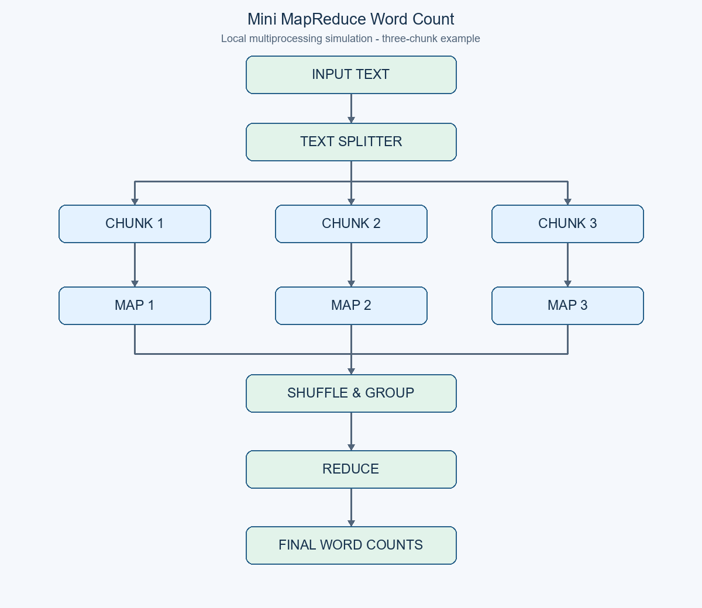
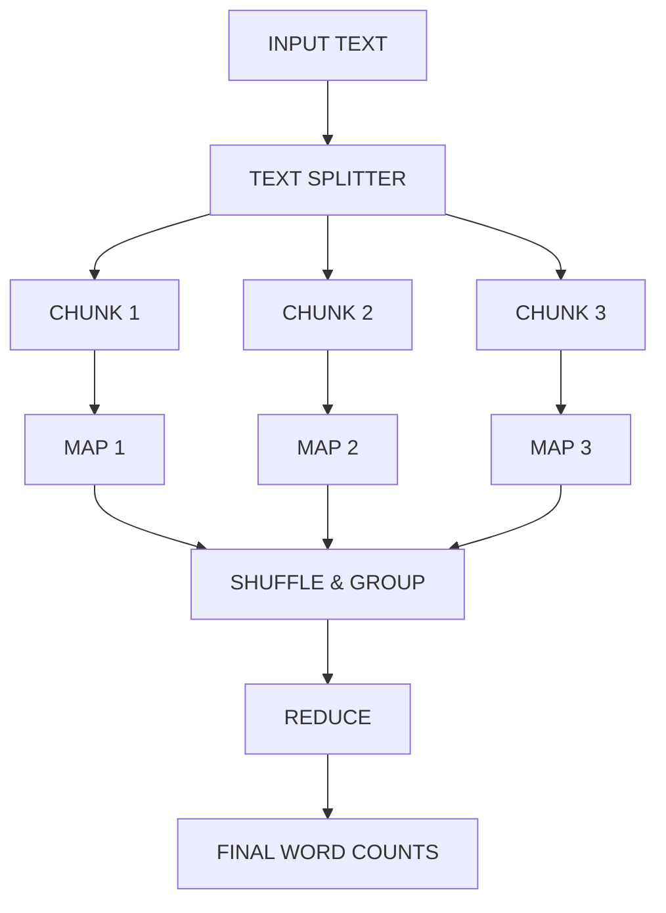

# Mini MapReduce Word Count Demo – Local Distributed Processing Simulation

This undergraduate mini-project demonstrates functional decomposition: split text,
map chunks independently, group intermediate counts, and reduce them into word totals.
It runs entirely on one machine. It is **not a real network-distributed cluster**.

## Files

```text
Group_XX_MapReduceWordCount/
├── code/
│   ├── app.py
│   ├── mapreduce.py
│   ├── requirements.txt
│   ├── sample_input.txt
│   └── tests/
│       └── test_mapreduce.py
├── README.md
├── group_details.txt
├── architecture.mmd
├── architecture.svg
├── architecture.png
├── demo_script.md
├── submission_checklist.md
└── peer_evaluation_checklist.md
```

The group must record and add the actual `demo_video.mp4` before submission.
No placeholder video is supplied. Rename the folder to
`Group_<Number>_MapReduceWordCount` and fill in `group_details.txt`.

## Features

- Manual input, UTF-8 `.txt` upload (up to 5 MiB), built-in sample, and clear button.
- Balanced chunks that never cut whitespace-delimited tokens; fewer tokens produce fewer chunks.
- Visible chunks, mapper outputs, shuffle groups, and final counts.
- Total words, unique words, most frequent word, and a top-10 bar chart.
- Sequential and process-pool mapping times, equality check, and sequential fallback.
- Tests with exact expected outputs, real process execution, and simulated pool failure.

## Technology and dependencies

Use Python **3.10 or newer**, Streamlit for the dashboard, and Pytest for testing.
`concurrent.futures.ProcessPoolExecutor`, `collections`, `re`, `pathlib`, and timing
come from Python's standard library. Runtime installation needs only
`code/requirements.txt`; no Hadoop, Spark, Docker, database, or cloud service is used.
Streamlit installs its own UI dependencies automatically.

## Architecture

1. The text splitter balances whitespace-delimited tokens across nonempty chunks.
2. Independent mapper tasks normalize and count the words in each chunk.
3. Shuffle collects the counts for each word from all mapper outputs.
4. Reduce sums each group, and the dashboard displays counts, charts, and timing.
5. A local process pool executes mapping; all workers share the same physical machine.



The editable Mermaid source is `architecture.mmd`; `architecture.svg` and
`architecture.png` are supplied exports with the same pipeline.



Three chunks illustrate the design; the app supports 1–32 chunks. A chunk is a task,
not a dedicated worker: the pool uses at most four processes by default, bounded
by the CPU count and number of chunks.

## Ubuntu installation and execution

Open a terminal in the parent directory containing the extracted project folder.
These commands assume the supplied `Group_XX_MapReduceWordCount` name; substitute
your renamed folder if applicable. Use an Ubuntu version with Python 3.10+.

```bash
sudo apt update
sudo apt install python3 python3-venv python3-pip -y

cd Group_XX_MapReduceWordCount/code

python3 -m venv .venv
source .venv/bin/activate

pip install -r requirements.txt

streamlit run app.py
```

Open the local URL printed by Streamlit, normally `http://localhost:8501`.
Stop the server with Ctrl+C. On later runs, enter `code`, activate `.venv`,
and run `streamlit run app.py` again. `python -m streamlit run app.py` is equivalent
and helps ensure the correct Python environment is used.

## Sample input and expected output

Load the sample button or upload `code/sample_input.txt`:

```text
apple banana apple orange banana apple
```

Choose three chunks and click **Run MapReduce**:

| Chunk | Text | Mapper result |
| --- | --- | --- |
| 1 | apple banana | `{"apple": 1, "banana": 1}` |
| 2 | apple orange | `{"apple": 1, "orange": 1}` |
| 3 | banana apple | `{"banana": 1, "apple": 1}` |

Shuffle: `apple → [1, 1, 1]`, `banana → [1, 1]`, `orange → [1]`.

| Word | Final count |
| --- | ---: |
| apple | 3 |
| banana | 2 |
| orange | 1 |

Total words: **6**. Unique words: **3**. Most frequent word: **apple**.

## Map, shuffle, and reduce

`map_chunk(chunk)` is a pure function returning a dictionary of local counts.
For example, `Apple, apple!` becomes `{"apple": 2}`. `shuffle_results(outputs)`
collects each mapper's local count into a list per word. A mapper contributes one
aggregated number per word it contains, not a separate `1` for every occurrence.
`reduce_counts(grouped_data)` sums these lists into the final dictionary.

Chunking uses `str.split()` and preserves every whitespace-delimited token exactly
once, while normalizing whitespace. Mapping extracts lowercase Unicode letter/digit
runs. Punctuation and underscores separate words: `can't` becomes `can`, `t`;
`red-blue` becomes `red`, `blue`. Digits count as words. Accented precomposed letters
such as `café` are supported. Combining marks are separators; this is a simple
teaching tokenizer, not a language-aware segmentation system. Total words refers
to normalized mapper tokens, which may differ from the whitespace token count.
Punctuation-only input produces a helpful warning. Frequency ties use alphabetical
order, including the most frequent word and the top-10 chart.

## Tests

From `code` with the virtual environment active:

```bash
python -m pytest -v
```

The suite covers empty input, single and repeated words, mixed case, punctuation,
whitespace/newlines, chunk preservation and balancing, excess requested chunks,
exact mapper/shuffle/reducer output, real sequential/parallel equality, total word
count consistency, invalid settings, and fallback after process creation failure.
The real-pool test intentionally fails if multiprocessing is unavailable so it
cannot silently verify a fallback instead of actual multiprocessing.

## Timing and limitations

The dashboard runs mapping twice over identical chunks: sequentially and using a
local process pool. Times measure **only the mapping passes**, excluding chunking,
shuffle, reduce, rendering, and upload. Parallel time includes startup, serialization,
and shutdown. If the pool fails, its time includes the failed attempt and sequential
retry, and the dashboard explicitly labels the fallback.

Multiprocessing is **not always faster**. Startup overhead often dominates small
inputs. These single runs are educational observations, not rigorous benchmarks.
Processes are independent but not guaranteed to execute simultaneously or to receive
exactly one chunk each. The app compares mapper outputs before displaying a result.
There is no network communication, distributed storage, persistent queue, cluster
scheduler, remote fault tolerance, or multi-machine scaling. All data and intermediate
dictionaries fit in local memory; uploaded files are limited to 5 MiB. Manual text
should also be kept modest for a classroom demo. Reruns create a new pool each time.

## Troubleshooting

| Problem | Action |
| --- | --- |
| `python3` is older than 3.10 | Use an Ubuntu installation offering Python 3.10+ and recreate the virtual environment. |
| `streamlit` or `pytest` is missing | Activate `.venv` and run `python -m pip install -r requirements.txt`. |
| Externally managed environment error | Install inside the virtual environment; do not use system-wide pip. |
| Port 8501 is occupied | Run `python -m streamlit run app.py --server.port 8502`. |
| Browser did not open | Copy the local URL printed in the terminal into your browser. |
| Uploaded file cannot be decoded | Save as UTF-8 plain text with a `.txt` extension. Binary and oversized files are rejected. |
| No words found | Enter letters or numbers; punctuation alone is not counted. |
| Fewer chunks than requested | There are fewer whitespace-delimited input tokens; empty chunks are omitted. |
| Results disappear after editing | Click Run MapReduce again; old results are hidden when input/settings change. |
| Parallel fallback appears | Check OS process restrictions and run from the supplied importable modules on a normal local Python installation. Sequential results remain usable. |
| Parallel test fails in a restricted sandbox | Repeat on a local machine that permits child processes; do not report fallback as successful parallel execution. |
| Multiprocessing is slower | Expected for small inputs; startup and transfer overhead may exceed useful work. |

## Group, demonstration, and submission

Enter actual group and member details in `group_details.txt`. Use `demo_script.md`
for a rehearsed recording of less than five minutes. Follow `submission_checklist.md`
for the final folder and Google Drive submission, and use
`peer_evaluation_checklist.md` when evaluating the instructor-assigned group.

| Rubric | Supporting material |
| --- | --- |
| Functionality — 5 marks | Working dashboard, pipeline functions, tests |
| Architecture clarity — 2 marks | Diagram exports, Mermaid source, explanation above |
| Demo video — 3 marks | Recording script; group must add actual video |
| Code and README quality — 2 marks | Importable functions, tests, installation and usage documentation |
| Peer evaluation — remaining 3 marks | Fair checklist; group must perform its assigned evaluation |

Marks are determined by the instructor. No upload, sharing change, submission,
recording, or peer-evaluation outcome is implied by these prepared files.
